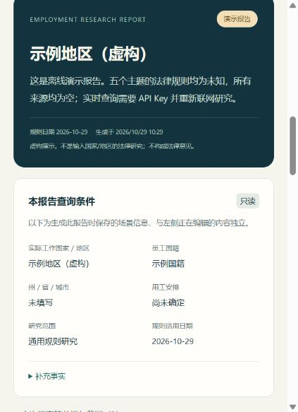

# 海外劳动合同与试用期核验 Agent

输入**实际工作国家/地区与员工国籍**，获得固定期限合同、合同期限、续签与转化、试用期、试用期绩效不符解除五类规则的研究报告。适用于 HR 前期核查、问题清单整理与法务/供应商沟通；个案判断会提示需要补充的事实。

提供两种用法：**本地网页**，或复制到具备联网能力的 AI 助手使用的 **[Agent 指令](prompts/agent-instructions.md) / [Skill](skills/global-employment-terms/SKILL.md)**。不依赖企业内部资料。

Local-first HR research assistant for employment terms and probation. Chinese reports, live web research with your own OpenAI API key, fictional offline demo, and reusable agent instructions. Python 3.10+, no third-party runtime dependencies.

**当前版本为初期研究工具。** 离线测试与网页演示已验证；真实 API 成功调用和国别法律解释质量尚未完成实测。验证范围见 [验证记录](docs/validation.md)。

[下载 ZIP](https://github.com/AlexDou-Y/global-employment-terms-agent/archive/refs/heads/main.zip) · [查看虚构报告样例](examples/demo-report.md) · [复制 Agent 指令](prompts/agent-instructions.md)

## 能做什么

| 核验主题 | 重点区分 |
| --- | --- |
| 固定期限合同是否允许 | 适用人员、使用理由、岗位/行业限制、书面要求 |
| 固定期限合同期限 | 单次上限、累计上限、下限、例外 |
| 续签与无固定期限转化 | 续签次数、间隔期、累计期限、自动转化或申请条件 |
| 试用期 | 初签/续签、期限、约定形式、延长/暂停、特殊人员 |
| 试用期绩效不符解除 | 法律依据、证明与程序、通知/补偿、特殊保护 |

报告区分**通用法律规则**与**个案是否满足条件**，列明来源、适用条件、未知项与下一步动作。支持 Markdown/JSON 导出、本地历史和通用规则卡复用。仅“通用规则”模式且补充说明为空的查询会自动保存为规则卡；带有场景补充或使用个案模式的报告不会自动进入通用规则库。每次实时查询都会重新联网研究，规则卡只作为检索线索。

## 本地启动

需要 [Python 3.10 或更高版本](https://www.python.org/downloads/) 和 [Git](https://git-scm.com/downloads)。没有 Git 时，可在本仓库页面选择 **Code → Download ZIP**，解压后进入项目目录。

### Windows PowerShell

```powershell
git clone https://github.com/AlexDou-Y/global-employment-terms-agent.git
Set-Location global-employment-terms-agent
python --version
python -m employment_agent
```

### macOS / Linux

```bash
git clone https://github.com/AlexDou-Y/global-employment-terms-agent.git
cd global-employment-terms-agent
python3 --version
python3 -m employment_agent
```

在浏览器打开 **[http://127.0.0.1:8765](http://127.0.0.1:8765)**，先运行“模拟演示”即可体验。演示使用虚构地区，不需要密钥或网络，也不代表任何国家的法律。终端按 `Ctrl+C` 停止服务。

默认仅监听 `127.0.0.1`。可以改端口或本地数据目录，例如：

```bash
python -m employment_agent --port 8766 --data-dir ../global-employment-terms-data
```

macOS/Linux 将上述 `python` 换成 `python3`。自定义数据目录应位于仓库外，或自行加入 `.gitignore`。本项目面向单用户本地运行，不提供公网部署方案。

可选：在虚拟环境中运行 `python -m pip install -e .`，之后也可用 `global-employment-terms-agent` 启动。直接从项目根目录启动无需安装依赖。

## 启用实时研究

使用自己的 [OpenAI API Key](https://platform.openai.com/api-keys)，联网研究产生的 API 用量由密钥所属账户承担。ChatGPT 订阅不等于已开通 API 余额或相关模型权限。

**方式一：单次输入。** 在网页的实时查询设置中填入密钥，仅用于当前请求；程序不将密钥写入报告、本地存储或历史记录。

**方式二：本地配置。** 在项目根目录复制配置模板：

```powershell
# Windows PowerShell
Copy-Item .env.example .env
notepad .env
```

```bash
# macOS / Linux
cp .env.example .env
# 用本地文本编辑器打开 .env
```

在 `.env` 中填写 `OPENAI_API_KEY`，保存后重新启动服务。服务会读取该文件，也支持预先设置的同名环境变量。不要提交 `.env`、密钥或真实员工信息。

`OPENAI_MODEL` 默认是 `gpt-5.5`，可在配置或单次查询中更换。选择支持 **Responses API、`web_search` 工具与结构化输出**的模型；实际可用性取决于模型与账户权限。遇到不支持或权限不足时，请按 API 报错核对配置，程序不会自动换用其他模型或将模型记忆充当联网结果。

## 如何解读结果

实时研究分两步：先通过 Responses API 联网检索并读取来源，再整理成固定结构的报告。程序核查搜索调用、来源轨迹、五项主题和输入日期等一致性；这些检查帮助发现缺口，**不能替代对法律原文及个案的专业判断**。

- **搜索结果出现 URL ≠ 已打开原文。** `observed_in_search` 表示 URL 出现在工具记录；`opened_by_tool` 表示工具轨迹明确记录了 `open_page`。即使打开过页面，也不证明已完整读取或正确解释相关条款。
- **官方来源标签由 AI 判断。** 程序不独立认证发布者的法律权威、法规现行效力或司法解释。缺少可靠原文、日期不明、来源冲突时应保留“待核验”。
- **规则明确 ≠ 个案可以执行。** 国籍不能代替实际工作地、雇佣主体、用工模式、合同历史和解除事实。解除、续签及合同变更前，应由当地法务/顾问核实适用依据与程序。

输入只提供国家和国籍时，默认研究通用规则；需要个案判断时，再补充省州、雇主/EOR、实际工作地、相关日期与合同历史等必要信息。请避免输入姓名、证件号码等无关个人信息。查询条件与研究所需内容会发送至 OpenAI；导出文件、历史报告和规则卡保存在本机数据目录，默认 `data/`，本地运行并不意味着实时研究完全离线。

## 复用指令与 Skill

直接复制 [prompts/agent-instructions.md](prompts/agent-instructions.md) 到支持联网搜索和网页读取的 AI 助手，即可按其中流程研究。没有联网能力时，指令要求明确披露缺口，不输出未经核实的国家规则。

支持文件夹式 Skill 的助手，可将 `skills/global-employment-terms/` **整个文件夹**复制到该助手支持的技能目录；不支持 Skill 的产品使用独立提示词即可。例如 Codex 使用默认技能目录时：

```powershell
# Windows PowerShell，在项目根目录执行
New-Item -ItemType Directory -Force -Path "$HOME/.codex/skills" | Out-Null
Copy-Item -Recurse -LiteralPath ./skills/global-employment-terms -Destination "$HOME/.codex/skills/"
```

```bash
# macOS / Linux，在项目根目录执行
mkdir -p "$HOME/.codex/skills"
cp -R ./skills/global-employment-terms "$HOME/.codex/skills/"
```

如设置了 `CODEX_HOME`，请使用该目录下的 `skills`；已有同名技能时先检查内容再替换。安装不会自动为助手配置联网工具或 API 权限。

## 常见问题

**没有 API Key 能用吗？** 可以使用虚构演示、查看和导出已有本地报告，也可以将提示词交给已有联网能力的助手；本地网页的实时研究需要自己的密钥。

**为什么要求补充信息？** 国别规则可能受省州、岗位、集体协议、用工模式、合同期限与历史影响。缺少个案事实时只能给出通用规则或条件判断。

**为什么有“待核验”，或者查询失败？** 可能是未找到官方原文、无法确认已打开相关页面、来源冲突，或 API 权限/网络/响应格式异常。未知不代表允许，失败也不产生一份假装完成的报告。

**规则卡可以直接复用为结论吗？** 不可以。它们仅保存通用研究线索；实时查询仍需按本次日期重查。自动积累只适用于 `query_mode=rules` 且 `details` 为空的查询，个案报告和有补充场景的查询不自动积累。

**如何清理本地记录？** 停止程序后，备份所需报告，再删除你指定数据目录内不再需要的记录。导出到其他目录的文件需自行管理。

## 开发与贡献

运行离线测试：

```bash
python -m unittest discover -s tests -v
```

测试使用模拟 API 响应，不需要密钥、不调用付费服务；通过测试不代表已验证真实联网效果或任何国家的法律结论。项目提供 [GitHub Actions 测试模板](docs/ci/offline-tests.yml)，覆盖 Windows / Ubuntu、Python 3.10 / 3.13。当前发布凭据未具备创建工作流的权限，因此未启用远端自动运行；仓库维护者可在授权后将模板复制到 `.github/workflows/tests.yml`。

接口与边界见 [设计说明](docs/design.md)，贡献要求见 [CONTRIBUTING.md](CONTRIBUTING.md)，公开虚构输入见 [examples/input.json](examples/input.json)。

<details>
<summary>查看演示页面截图（窄屏）</summary>



</details>

MIT License · Copyright 2026 Alex Dou。许可适用于本项目代码与指令；外部法规和网页内容遵循各自权利及使用条件。
