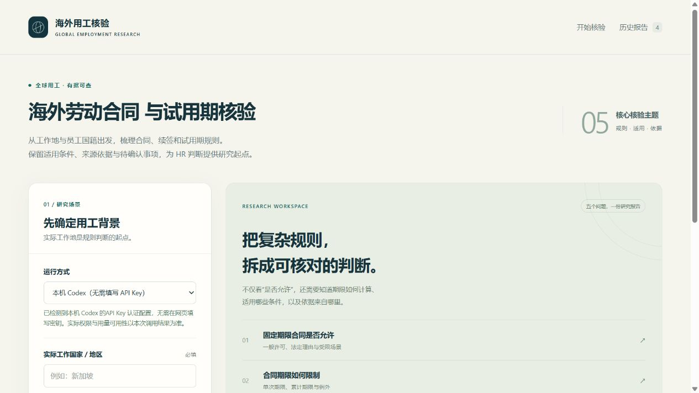

# 海外劳动合同与试用期核验 Agent

输入**实际工作国家/地区与员工国籍**，获得固定期限合同、合同期限、续签与转化、试用期、试用期绩效不符解除五类规则的研究报告。适用于 HR 前期核查、问题清单整理与法务/供应商沟通；个案判断会提示需要补充的事实。

提供两种用法：**本地网页**，或复制到具备联网能力的 AI 助手使用的 **[Agent 指令](prompts/agent-instructions.md) / [Skill](skills/global-employment-terms/SKILL.md)**。不依赖企业内部资料。

Local-first HR research assistant for employment terms and probation. Chinese reports, live web research through your locally authenticated Codex CLI, optional direct OpenAI API mode, fictional offline demo, and reusable agent instructions. Python 3.10+, no third-party Python runtime dependencies.

**v0.2 默认使用本机 Codex，无需在网页填写 API Key。** 程序复用本机 Codex CLI 的已有认证；仍需可用的模型服务、联网能力和账户权限，用量与费用遵循现有 Codex 认证方式。当前版本为初期研究工具，本机 Codex、直连 API 和离线演示的验证范围分别见 [验证记录](docs/validation.md)，不能将某一模式的测试结果视为其他模式或国别法律结论已验证。

[下载 ZIP](https://github.com/AlexDou-Y/global-employment-terms-agent/archive/refs/heads/main.zip) · [查看虚构报告样例](examples/demo-report.md) · [复制 Agent 指令](prompts/agent-instructions.md)

已通过 121 项离线测试，并通过本机 Codex 实测完成新加坡场景的五问报告。证据不完整的事项仍保留限制，不作为法律签批。



## 能做什么

| 核验主题 | 重点区分 |
| --- | --- |
| 固定期限合同是否允许 | 适用人员、使用理由、岗位/行业限制、书面要求 |
| 固定期限合同期限 | 单次上限、累计上限、下限、例外 |
| 续签与无固定期限转化 | 续签次数、间隔期、累计期限、自动转化或申请条件 |
| 试用期 | 初签/续签、期限、约定形式、延长/暂停、特殊人员 |
| 试用期绩效不符解除 | 法律依据、证明与程序、通知/补偿、特殊保护 |

报告区分**通用法律规则**与**个案是否满足条件**，列明来源、适用条件、未知项与下一步动作。支持 Markdown/JSON 导出、本地历史和通用规则卡复用。仅“通用规则”模式且补充说明为空的查询会自动保存为规则卡；带有场景补充或使用个案模式的报告不会自动进入通用规则库。每次实时查询都会重新联网研究，规则卡只作为检索线索。

## 本地启动

需要 [Python 3.10 或更高版本](https://www.python.org/downloads/) 和 [Git](https://git-scm.com/downloads)。没有 Git 时，可在本仓库页面选择 **Code → Download ZIP**，解压后进入项目目录。

### Windows PowerShell

```powershell
git clone https://github.com/AlexDou-Y/global-employment-terms-agent.git
Set-Location global-employment-terms-agent
python --version
python -m employment_agent
```

### macOS / Linux

```bash
git clone https://github.com/AlexDou-Y/global-employment-terms-agent.git
cd global-employment-terms-agent
python3 --version
python3 -m employment_agent
```

启动后按三步使用：

1. 在浏览器打开 **[http://127.0.0.1:8765](http://127.0.0.1:8765)**。
2. 保持默认的“本机 Codex”运行方式，查看页面显示的 CLI 和认证配置状态。
3. 输入实际工作国家/地区、员工国籍，开始实时查询。模型留空时沿用本机 Codex 配置。

尚未安装或登录 Codex 时，按下节完成一次本机准备。也可以先运行“模拟演示”：演示使用虚构地区，无需 Codex CLI、密钥或网络，不代表任何国家的法律。终端按 `Ctrl+C` 停止服务。

默认仅监听 `127.0.0.1`。可以改端口或本地数据目录，例如：

```bash
python -m employment_agent --port 8766 --data-dir ../global-employment-terms-data
```

macOS/Linux 将上述 `python` 换成 `python3`。自定义数据目录应位于仓库外，或自行加入 `.gitignore`。本项目面向单用户本地运行，不提供公网部署方案。

可选：在虚拟环境中运行 `python -m pip install -e .`，之后也可用 `global-employment-terms-agent` 启动。直接从项目根目录启动无需安装依赖。

## 启用实时研究

### 默认方式：本机 Codex

已在本机使用 Codex CLI 并完成认证的用户，通常无需新增配置。请在启动网页服务的同一终端中确认 `codex --version` 可以运行；程序通过系统 `PATH` 查找 CLI。

首次使用时，按 [Codex CLI 官方安装说明](https://developers.openai.com/codex/cli/) 安装，随后由本人在终端执行：

```bash
codex login
```

按提示使用具备 Codex 使用权限的 ChatGPT 账户登录，或继续使用已配置的 Codex 认证方式。安装后若当前终端仍找不到 `codex`，请重新打开终端再启动本项目。认证方式、账户权限和用量规则见 [官方认证说明](https://developers.openai.com/codex/auth)。

网页会显示 CLI 是否可用、认证配置状态及相关提示。**检测到认证配置不等于真实调用已成功**；模型权限、搜索能力、网络、余额或额度仍以实际研究调用为准。程序不会代替用户登录，不读取或复制 `auth.json`，也不修改全局 Codex 配置。请勿在聊天、问题反馈或仓库中分享凭据。

模型默认留空，沿用本机 Codex 配置；需要时可在网页或 `CODEX_MODEL` 指定。研究调用使用临时工作目录、只读沙箱和非持久会话，并关闭与网页研究无关的本地工具能力。调用机制参见 [Codex 非交互模式](https://developers.openai.com/codex/noninteractive) 和 [项目设计说明](docs/design.md)。本机模式失败时不会自动切换到直连 API。

### 可选方式：直连 OpenAI API

在网页将运行方式切换为“OpenAI API”，使用自己的 [OpenAI API Key](https://platform.openai.com/api-keys)。联网研究产生的 API 用量由密钥所属账户承担；ChatGPT 订阅不等于已开通 API 余额或相关模型权限。此模式不要求安装 Codex CLI。

**方式一：单次输入。** 在网页的 API 运行设置中填入密钥，仅用于当前请求；程序不将密钥写入报告、本地存储或历史记录。

**方式二：本地配置。** 按下方说明创建 `.env`，填写 `OPENAI_API_KEY` 后重新启动服务。`OPENAI_MODEL` 默认是 `gpt-5.5`，只用于直连 API 模式，也可在单次查询中更换。所选模型须支持 **Responses API、`web_search` 工具与结构化输出**，实际可用性取决于模型与账户权限。遇到不支持或权限不足时，请按报错核对配置；程序不会自动换用其他模型或将模型记忆充当联网结果。

### 可选本地配置

本机 Codex 默认模式无需创建 `.env`。需要调整默认运行方式或模型时，可在项目根目录复制配置模板：

```powershell
# Windows PowerShell
Copy-Item .env.example .env
notepad .env
```

```bash
# macOS / Linux
cp .env.example .env
# 用本地文本编辑器打开 .env
```

| 设置 | 默认值 | 用途 |
| --- | --- | --- |
| `EMPLOYMENT_AGENT_PROVIDER` | `codex` | 默认运行方式；可设为 `openai` |
| `CODEX_MODEL` | 空 | 本机 Codex 模型；空值沿用 Codex 自身配置 |
| `OPENAI_API_KEY` | 空 | 仅用于直连 API 模式 |
| `OPENAI_MODEL` | `gpt-5.5` | 仅用于直连 API 模式 |

修改后重新启动服务。服务会读取 `.env`，也支持预先设置的同名环境变量；环境变量优先。不要提交 `.env`、密钥或真实员工信息。

## 如何解读结果

实时研究先联网检索并读取来源，再整理成固定结构的报告。本机模式通过 Codex CLI 调用；直连 API 模式通过 Responses API 调用。两种模式均核查真实搜索调用、来源轨迹、五项主题和输入日期等一致性；这些检查帮助发现缺口，**不能替代对法律原文及个案的专业判断**。

- **搜索结果出现 URL ≠ 已打开原文。** `observed_in_search` 表示 URL 出现在工具记录；`opened_by_tool` 表示工具轨迹明确记录了 `open_page`。即使打开过页面，也不证明已完整读取或正确解释相关条款。
- **最终报告中的链接不能自证核验。** 本机 Codex 模式以本次 CLI JSONL 事件中的真实工具轨迹核对来源；若 CLI 只提供有限搜索记录，程序按可见证据降级或拒绝结果，不把模型正文中的 URL 当作已访问来源。
- **官方来源标签由 AI 判断。** 程序不独立认证发布者的法律权威、法规现行效力或司法解释。缺少可靠原文、日期不明、来源冲突时应保留“待核验”。
- **规则明确 ≠ 个案可以执行。** 国籍不能代替实际工作地、雇佣主体、用工模式、合同历史和解除事实。解除、续签及合同变更前，应由当地法务/顾问核实适用依据与程序。

输入只提供国家和国籍时，默认研究通用规则；需要个案判断时，再补充省州、雇主/EOR、实际工作地、相关日期与合同历史等必要信息。请避免输入姓名、证件号码等无关个人信息。查询条件与研究所需内容会发送至所选模式的模型服务：本机模式遵循 Codex 已有服务与认证配置，直连 API 模式发送至 OpenAI。导出文件、历史报告和规则卡保存在本机数据目录，默认 `data/`；报告标明运行方式。本地运行并不意味着实时研究完全离线。

## 复用指令与 Skill

直接复制 [prompts/agent-instructions.md](prompts/agent-instructions.md) 到支持联网搜索和网页读取的 AI 助手，即可按其中流程研究。没有联网能力时，指令要求明确披露缺口，不输出未经核实的国家规则。

支持文件夹式 Skill 的助手，可将 `skills/global-employment-terms/` **整个文件夹**复制到该助手支持的技能目录；不支持 Skill 的产品使用独立提示词即可。例如 Codex 使用默认技能目录时：

```powershell
# Windows PowerShell，在项目根目录执行
New-Item -ItemType Directory -Force -Path "$HOME/.codex/skills" | Out-Null
Copy-Item -Recurse -LiteralPath ./skills/global-employment-terms -Destination "$HOME/.codex/skills/"
```

```bash
# macOS / Linux，在项目根目录执行
mkdir -p "$HOME/.codex/skills"
cp -R ./skills/global-employment-terms "$HOME/.codex/skills/"
```

如设置了 `CODEX_HOME`，请使用该目录下的 `skills`；已有同名技能时先检查内容再替换。安装不会自动为助手配置联网工具或 API 权限。

## 常见问题

**没有 API Key 能用吗？** 可以。默认本机 Codex 模式复用 CLI 已有认证，不要求在网页填写密钥；首次使用需安装 CLI 并完成认证。也可以使用无需 CLI 或联网的虚构演示，或将提示词交给已有联网能力的助手。只有直连 OpenAI API 模式要求 API Key。

**本机 Codex 模式是否免费？** 本项目代码按 MIT 许可提供，模型调用仍遵循现有 Codex 账户、套餐、认证方式及服务商的费用和额度规则；本项目不提供模型额度。

**页面提示已有认证，为什么仍调用失败？** 状态检测仅说明 CLI 发现了认证配置，不能确认模型访问权限、搜索能力、可用额度或网络连通性。请按页面错误提示检查本机 Codex；程序不会自动登录或改用另一种计费方式。

**为什么要求补充信息？** 国别规则可能受省州、岗位、集体协议、用工模式、合同期限与历史影响。缺少个案事实时只能给出通用规则或条件判断。

**为什么有“待核验”，或者查询失败？** 可能是未找到官方原文、无法确认已打开相关页面、来源冲突，或 Codex / API 权限、额度、网络、响应格式异常。未知不代表允许，失败也不产生一份假装完成的报告。

**规则卡可以直接复用为结论吗？** 不可以。它们仅保存通用研究线索；实时查询仍需按本次日期重查。自动积累只适用于 `query_mode=rules` 且 `details` 为空的查询，个案报告和有补充场景的查询不自动积累。

**如何清理本地记录？** 停止程序后，备份所需报告，再删除你指定数据目录内不再需要的记录。导出到其他目录的文件需自行管理。

## 开发与贡献

运行离线测试：

```bash
python -m unittest discover -s tests -v
```

离线测试使用模拟 Codex 进程和 API 响应，不需要密钥、不调用付费服务；通过测试不代表已验证真实联网效果或任何国家的法律结论。真实调用的模式、结果和限制另见 [验证记录](docs/validation.md)。项目提供 [GitHub Actions 测试模板](docs/ci/offline-tests.yml)，覆盖 Windows / Ubuntu、Python 3.10 / 3.13。当前发布凭据未具备创建工作流的权限，因此未启用远端自动运行；仓库维护者可在授权后将模板复制到 `.github/workflows/tests.yml`。

接口与边界见 [设计说明](docs/design.md)，贡献要求见 [CONTRIBUTING.md](CONTRIBUTING.md)，公开虚构输入见 [examples/input.json](examples/input.json)。

<details>
<summary>查看演示页面截图（窄屏）</summary>


</details>

MIT License · Copyright 2026 Alex Dou。许可适用于本项目代码与指令；外部法规和网页内容遵循各自权利及使用条件。
